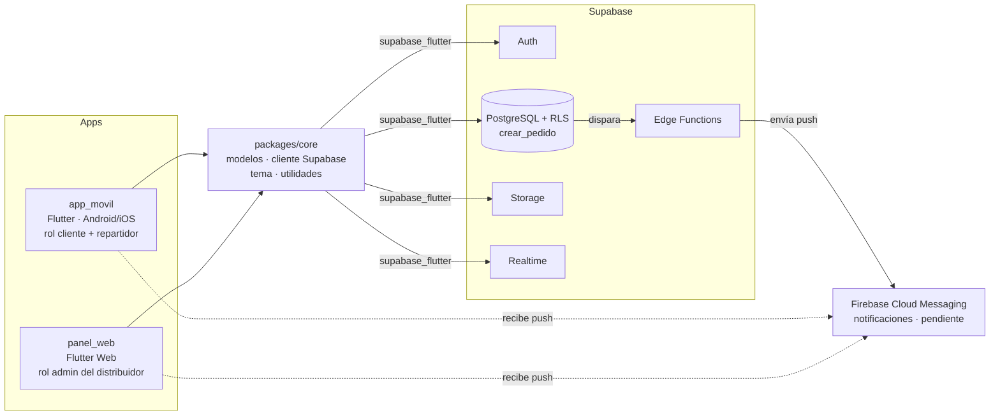
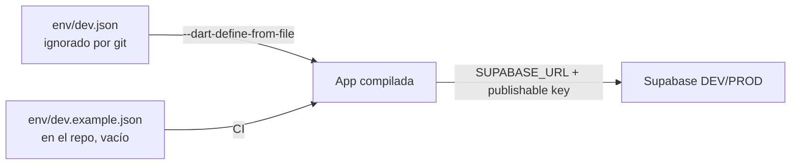

# Arquitectura

## Visión general



## Regla de dependencias

```
apps/app_movil ──┐
                 ├──► packages/core ──► Supabase (vía supabase_flutter)
apps/panel_web ──┘
```

- **Las apps dependen de `core`. `core` no depende de ninguna app.**
- **`core` no depende de `go_router` ni de Riverpod de UI.** Solo define modelos, cliente, tema y utilidades.
- **Las apps no se importan entre sí.**

## Capas dentro de cada app

Cada feature sigue el mismo esquema:

```
lib/
├── main.dart                  ← lee el entorno, inicializa Supabase, arranca
├── app.dart                   ← MaterialApp.router + tema
└── src/
    ├── config/                ← rutas y constantes de la app
    ├── router/                ← go_router + redirección por sesión/rol
    ├── shared/                ← widgets comunes de la app
    └── features/<feature>/
        ├── data/              ← repositorios concretos (consultas a Supabase)
        ├── domain/            ← contratos e interfaces (sin Flutter ni Supabase)
        └── presentation/      ← pantallas, widgets y providers de Riverpod
```

| Capa | Puede importar | No puede importar |
|---|---|---|
| `presentation` | `domain`, `core`, Flutter | `data` directamente (va vía providers) |
| `domain` | `core` (solo modelos) | Flutter, Supabase |
| `data` | `domain`, `core`, `supabase_flutter` | `presentation` |

## Dónde va cada cosa

| Si es... | Va en... |
|---|---|
| Modelo que usan ambas apps (Pedido, Producto...) | `packages/core/lib/src/models/` |
| Cliente o inicialización de Supabase | `packages/core/lib/src/supabase/` |
| Tema o color del distribuidor | `packages/core/lib/src/theme/` |
| Formateo de dinero, extensiones | `packages/core/lib/src/utils/` |
| Pantalla o widget de una sola app | `apps/<app>/lib/src/features/<feature>/presentation/` |
| Consulta a una tabla | `apps/<app>/lib/src/features/<feature>/data/` |
| Regla de negocio que vive en la BD (stock, precios) | Migración en `supabase/migrations/` con función SQL, no en Dart |
| Endpoint que necesita secretos o service role | Edge Function en `supabase/functions/` |

**Regla de oro:** la lógica que protege el dinero o el stock vive en la base de datos (función transaccional + RLS), no solo en la app. La app puede validar para dar buena experiencia, pero la BD es la que decide.

## Configuración de entorno



- Solo se usa la **publishable key** (`sb_publishable_...`). La **secret key** (`sb_secret_...`) nunca entra al cliente ni al repo.
- Si faltan las claves, la app muestra `PantallaConfigFaltante` en lugar de fallar en silencio.

## Notificaciones (pendiente)

FCM está preparado como dependencia en `app_movil` (`firebase_core`, `firebase_messaging`) pero **no se inicializa**. Pasos en el README.
